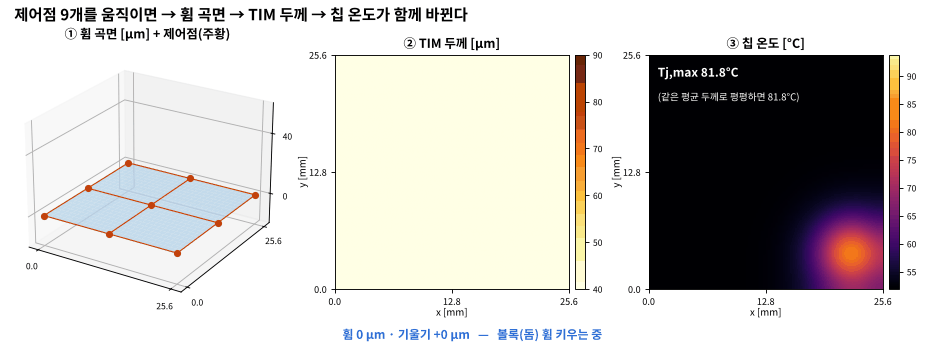

# 칩 휨에 따른 TIM 두께 불균일과 온도 분포 예측 — 대리모델 프로젝트

설계방법론 팀 프로젝트 (2026학년도 2학기). 칩이 휘면 냉각판과의 틈(TIM) 두께가 위치마다 달라지고, 두꺼운 곳에 핫스팟이 생긴다.
**휨 모양 · TIM 열전도율 · 핫스팟 위치와 세기**를 넣으면 **칩 최고 온도(Tj,max)와 온도 지도**를 바로 내놓는 대리모델(GPR / ANN)을 만들고, 몬테카를로로 **불량률(Tj,max > 105°C)**을 계산한다.



처음이라면 [`docs/team_guide.pdf`](docs/team_guide.pdf) (팀원용 설명서 9쪽)부터 읽기. 모델 사양은 [`docs/problem_model.pdf`](docs/problem_model.pdf).

---

## 빠른 시작

```bash
pip install -r requirements.txt
pytest -q                                              # 해석기 검증 테스트 11개
python solver/solver.py                                # 예시 1회 계산 (약 0.05초)
python doe/make_doe.py --n 100 --out data/data_v0      # 파일럿 데이터 100개 (약 4초)
```

해석기 사용법:

```python
import sys; sys.path.insert(0, "solver")
from solver import load_params, solve
p = load_params()
x = [55e-6, 25e-6, 25e-6, 0, 0, 3.0, 22e-3, 4e-3, 170e4]   # 아래 '입력 벡터' 순서, SI 단위
tmax, T = solve(x, p)                                       # Tj,max [°C], 온도 지도 (64×64)
```

## 입력 벡터 x (순서 고정)

| # | 이름 | 의미 | 범위 (초안) |
|---|---|---|---|
| 0 | `w_center` | 휨 제어점: 칩 중앙 높이 | 0 ~ 70 μm |
| 1 | `w_mid_x` | 휨 제어점: 아래·위 변 가운데 | −20 ~ 40 μm |
| 2 | `w_mid_y` | 휨 제어점: 왼쪽·오른쪽 변 가운데 | −20 ~ 40 μm |
| 3 | `tilt_x` | 조립 기울기 (x) | ±10 μm (가정) |
| 4 | `tilt_y` | 조립 기울기 (y) | ±10 μm (가정) |
| 5 | `k_tim` | TIM 열전도율 | 1.5 ~ 6 W/m·K |
| 6 | `hs_x` | 핫스팟 중심 x | 2 ~ 23.6 mm |
| 7 | `hs_y` | 핫스팟 중심 y | 2 ~ 23.6 mm |
| 8 | `hs_q` | 핫스팟 추가 열유속 | 80 ~ 240 W/cm² |

모든 값과 고정값(칩 크기, k_Si, 냉각판 h, 평균 발열, 불량 기준)은 **[`params.yaml`](params.yaml) 한 곳에만** 있다. 코드에 숫자를 직접 쓰지 말 것.

## 역할과 마감

| 역할 | 책임지는 질문 | 주요 산출물 |
|---|---|---|
| **A** 문제 정의·스토리 | 왜 중요하고, 수치는 현실적인가? | `params.yaml` 확정, 기준값 출처 표, `mc/mc_spec.yaml`, 발표 PPT |
| **B** 형상·해석기 | 해석기를 믿을 수 있나? | `solver/`, `tests/`, 격자·층 수 수렴, 3×3 vs 4×4 제어점 비교 |
| **C** 3D 검증·데이터 | 2.5D 가정이 맞고, 데이터는 충분한가? | `doe/`, `data/`, `validation/ansys3d/val_3d.csv` |
| **D** GPR·불량률 | 불량률을 얼마나 정확히 내나? | `models/gpr/`, 몬테카를로 불량률, 해석기 대비 시간·정확도 표 |
| **E** 온도장·설계 | 온도 지도를 맞히고 설계를 개선할 수 있나? | `models/field/` (PCA + ANN), 가장자리 TIM 최적화 |

| 날짜 | 마일스톤 |
|---|---|
| **11/15 (일)** | `params.yaml` 확정 (A) |
| 11/16 (월) | 해석기 정리·테스트 (B) — 시작 코드는 이미 동작 |
| 11/17 (화) | 파일럿 데이터 `data_v0` 공유 (C) → D, E 파이프라인 시작 |
| 11/18 (수) | 입력 → 해석 → 학습 → 불량률이 작은 데이터로 끝까지 1회 실행 |
| 11/22 (일) | 본 데이터 `data_v1` (2,000개 이상) + 분할 고정, Ansys 3D 비교 (C) |
| 11/23 (월) | `pca.npz` 공유 (E) |
| 11/25 (수) | 몬테카를로 분포 `mc_spec.yaml` + 공용 표본 `mc_X.npy` (A·D) |
| 11/26 (목) | `predict_tmax(x)`, `predict_field(x)` 공유 (D, E) |
| **11/30 (월)** | **코드 동결**, test 세트로 최종 평가 1회 |
| 12/2 (수) | PPT 초안 · 12/7 (월) 13:00 제출 · 12/8 (화) 발표 |

## 폴더 구조

```
params.yaml          공통 사양 (A)
solver/              geometry.py (휨 곡면·TIM 두께), solver.py (2.5D 열 해석) (B)
tests/               해석기 검증 테스트 (B)
doe/                 make_doe.py: LHS → 해석 → 데이터셋 (C)
data/                data_v0/, data_v1/ … (큰 파일은 git에 올리지 않음, 아래 규칙 참고)
validation/ansys3d/  Ansys 3D 비교 (C)
models/gpr/          Tj,max GPR (D)
models/field/        PCA + ANN 온도장 (E)
mc/                  몬테카를로 분포·표본·불량률 (A·D)
figures/             발표용 그림: 역할_내용_v번호.png
docs/                설명서 PDF, GIF
```

## 데이터셋 형식 (`data/data_vN/`)

| 파일 | 모양 | 내용 |
|---|---|---|
| `X.npy` | (n, 9) | 입력, SI 단위, 위 표 순서 |
| `Tmax.npy` | (n,) | Tj,max [°C] |
| `Tfield.npy` | (n, 64, 64) float32 | 온도 지도 [°C], 행 = y |
| `doe_X.csv` | n 행 | `X.npy`와 같은 값 (엑셀 확인용) |
| `split.json` | — | `train` / `val` / `test` 인덱스 (시드 고정) |
| `meta.json` | — | 개수, 격자, params 버전, git 커밋, 생성 시각 |

## 팀 규칙

1. **사양은 `params.yaml` 한 곳에만.** 값을 바꾸면 `version`을 올리고 단톡에 공지.
2. **데이터는 버전 폴더로.** `data_v0`, `data_v1`… 덮어쓰지 말고 새 버전을 만든다.
3. **test 세트는 11/30 이후 최종 평가에 한 번만.** 그 전에는 train/val만 쓴다.
4. **정규화는 각 모델 안에서** train 기준으로. 공유 파일은 물리 단위 그대로.
5. **큰 파일(`*.npy`, 10 MB 이상)은 git에 올리지 않는다.** 구글 드라이브에 올리고 링크를 `data/README.md`에 적는다. 누구나 `make_doe.py`로 똑같이 다시 만들 수 있다 (시드 고정).
6. **AI로 만든 코드에는 검증을 붙인다.** 무엇을 AI로 만들고 어떻게 확인했는지 PR 설명이나 커밋 메시지에 한 줄 남긴다 (개인 포트폴리오 근거).
7. **`main`에 직접 푸시하지 말고** 역할별 브랜치(`b-solver`, `c-doe` …)에서 작업 후 Pull Request.

## 현재 상태

- **해석기: 실리콘 2층 다층 2.5D** (params v0.2, `si_layers: 2`). 결정 근거와 검증은 [`solver/README.md`](solver/README.md)
  - 축별 비오 수: 실리콘 Bi_z 0.09~0.29 → 두께 방향 분할 필요, TIM은 위치별 1D 저항이 정확
  - 실리콘 12층 대비 오차: 평균 0.15 K, 최악 조건 0.44 K (기존 1층 2.5D는 최대 4.4 K 과소평가)
  - 격자 64: 격자 256 대비 평균 0.05 K, 최대 0.15 K · 1회 약 35~40 ms
  - 테스트 11개 통과 (해석해, 에너지 보존, 대칭, 층 수 회귀 등)
- 파일럿 300개: Tj,max 60 ~ 120°C, **105°C 초과 5%** (중앙값 82°C)
- 확인 필요(가정값): 냉각판 h와 바닥판 퍼짐, 핫스팟 세기 범위, 기울기 범위, 몬테카를로 분포
