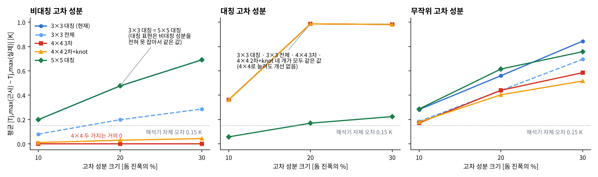
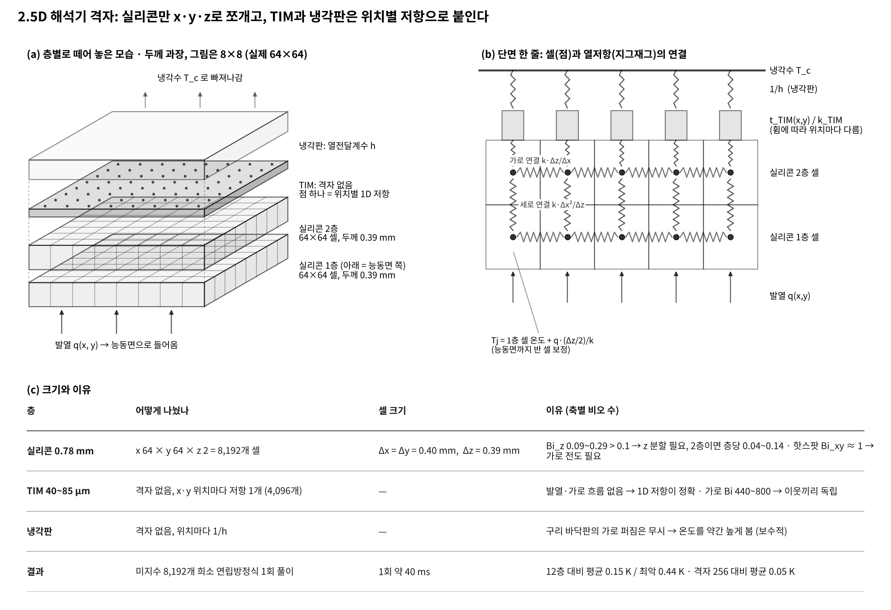
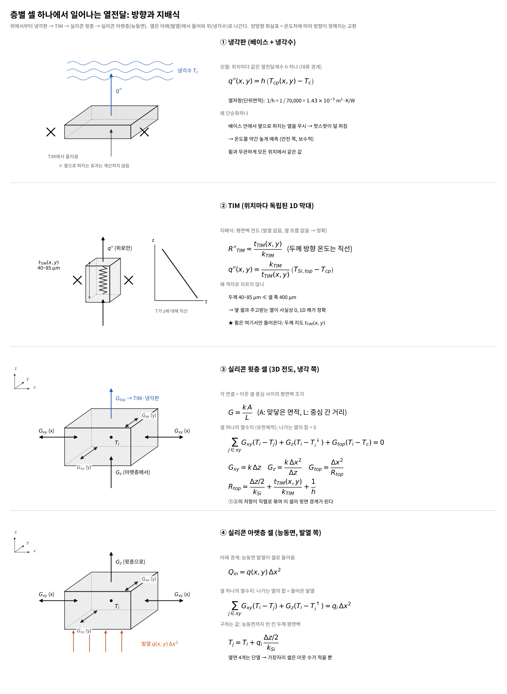
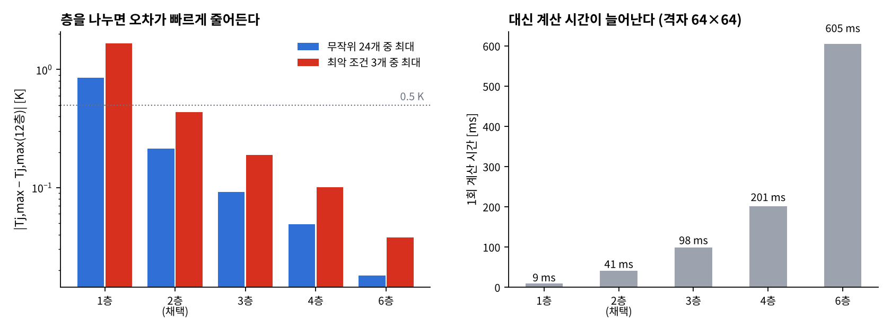
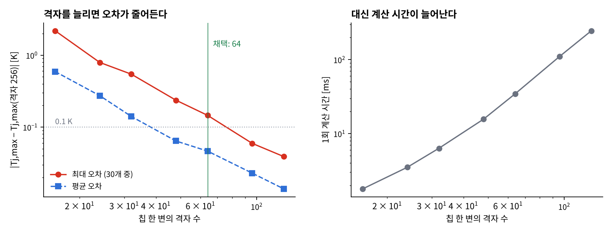

# B 역할 결과 보고서: 형상·해석기

주제 6 · 칩 휨에 따른 TIM 두께 불균일과 접합부 온도 · 담당 B (형상·해석기) · 2026-11-14

---

## 0. 요약

**B가 책임지는 질문: "데이터를 만드는 해석기를 믿을 수 있나?"**

| 항목 | 결과 |
|---|---|
| 해석기 | 실리콘 2층 × 64×64 절점, TIM·냉각판은 위치별 평면벽 저항. 1회 약 35~40 ms |
| 휨 표현 | 3×3 제어점 대칭 2차 B-spline + 조립 기울기. 휨 관련 입력 5개 (전체 입력 9개) |
| 해석해 비교 | 균일 조건 손계산 51.90 °C = 해석기 51.90 °C. 시험 11개 모두 통과 |
| 실리콘 층 수 | 2층: 12층 대비 평균 +0.15 K, 최대 0.44 K |
| 격자 | 64×64: 256×256 대비 평균 0.05 K, 최대 0.15 K |
| 휨 표현 오차 | 고차 성분 ±5 μm일 때 평균 0.3 K. 4×4로 늘려도 대칭 형상은 개선 없음 |
| 해석기 전체 오차 | 1 K 미만. 휨 효과(2~10 K)보다 충분히 작다 |
| 파일럿 300개 | Tj,max 중앙값 82 °C, 상위 1% 110 °C, 105 °C 초과 5% |

---

## 1. 역할과 산출물

| 산출물 | 위치 | 쓰는 사람 |
|---|---|---|
| 해석기 `solve(x, p)` → (Tj,max, Tj 지도 64×64) | `solver/solver.py` | C (데이터 생성), D·E (검증) |
| 휨 곡면 → TIM 두께 지도 | `solver/geometry.py` | 전원 |
| 공통 사양 (입력 순서·범위·고정값) | `params.yaml` | 전원 |
| 데이터 생성 스크립트 (LHS, 분할) | `doe/make_doe.py` | C |
| 시험 11개 | `tests/test_solver.py` | 전원 (`pytest -q`) |
| 검증 연구 스크립트와 결과 | `solver/studies/` | 발표 자료 |

---

## 2. 형상: 휨 곡면과 TIM 두께

### 2.1 입력 매개변수 (9개, 순서 고정)

| # | 이름 | 뜻 | 범위 |
|---|---|---|---|
| 1 | `w_center` | 휨 제어점: 칩 중앙 높이 | 0 ~ 70 μm |
| 2 | `w_mid_x` | 휨 제어점: 위·아래 변 가운데 (x 방향 굽힘) | −20 ~ 40 μm |
| 3 | `w_mid_y` | 휨 제어점: 좌·우 변 가운데 (y 방향 굽힘) | −20 ~ 40 μm |
| 4 | `tilt_x` | 조립 기울기 (x 방향 양 끝 높이 차) | ±10 μm (가정) |
| 5 | `tilt_y` | 조립 기울기 (y 방향) | ±10 μm (가정) |
| 6 | `k_tim` | TIM 열전도율 | 1.5 ~ 6 W/m·K |
| 7, 8 | `hs_x`, `hs_y` | 핫스팟 중심 | 2 ~ 23.6 mm |
| 9 | `hs_q` | 핫스팟 추가 열유속 (최댓값) | 80 ~ 240 W/cm² |

제약: 기울기를 뺀 휨 곡면의 최고-최저 차 ≤ 45 μm.

고정값: 다이 25.6 × 25.6 × 0.78 mm, $k_{Si}$ = 130 W/m·K, $h$ = 70,000 W/m²·K, $T_c$ = 25 °C, 평균 열유속 80 W/cm², 최소 TIM 두께 40 μm, 핫스팟 크기 σ = 2 mm.

### 2.2 휨 곡면 표현

작동 온도에서 다이는 냉각판 쪽으로 볼록한 돔이 된다. 그래서 TIM은 중앙이 얇고 가장자리·모서리가 두껍다.

**휨 곡면**: 3×3 제어점 2차 B-spline (clamped, 한 조각). 휨이 x·y 방향으로 거울 대칭이라고 보고 제어점을 3개로 줄인다. 모서리 제어점은 0 기준이다.

$$
P = \begin{bmatrix} 0 & w_{mid,x} & 0 \\ w_{mid,y} & w_{center} & w_{mid,y} \\ 0 & w_{mid,x} & 0 \end{bmatrix},
\qquad
w(x,y) = \sum_{i=0}^{2}\sum_{j=0}^{2} B_i(u)\,B_j(v)\,P_{ij}
$$

여기에 조립 기울기 평면 $\text{tilt}_x\,u' + \text{tilt}_y\,v'$를 더한다 ($u', v'$: 칩 중심 기준 −½ ~ ½).

**TIM 두께 지도**: 가장 높은 곳(냉각판에 가장 가까운 곳)의 TIM이 최소 두께가 된다.

$$
t_{TIM}(x,y) = t_{min} + \left(\max w - w(x,y)\right), \qquad t_{min} = 40\ \mu\text{m}
$$

실리콘 자체는 평평하다고 본다 (곡률 반경 약 2 m, 기울기 0.006 rad 이하). 휨은 TIM 두께를 통해서만 열 해석에 들어간다.

### 2.3 제어점 개수 판단: 3×3이면 충분한가

**① 대칭을 유지한 4×4는 3×3과 같다.** 3차 Bezier에 좌우 대칭($P_0 = P_3$, $P_1 = P_2$)을 걸면

$$
B(t) = P_0 + 3(P_1 - P_0)\,t(1-t)
$$

로 2차식이 된다. 표현할 수 있는 모양이 하나도 늘지 않는다. 대칭인 고차 형상을 담으려면 방향마다 제어점 5개(5×5)가 필요하다.

**② 고차 성분 종류별 Tj,max 오차** (고차 성분 = 돔 진폭의 20%, 조건 30개 평균 |ΔTj,max|):

| 고차 성분 | 3×3 대칭 (현재) | 3×3 전체 | 4×4 3차 | 4×4 2차 | 5×5 대칭 |
|---|---|---|---|---|---|
| 비대칭 (꼭대기 쏠림) | 0.48 K | 0.20 K | 0.00 K | 0.03 K | 0.48 K |
| 대칭 (평평한 꼭대기·가장자리 처짐) | 0.99 K | 0.99 K | 0.99 K | 0.99 K | 0.17 K |
| 무작위 | 0.56 K | 0.44 K | 0.44 K | 0.40 K | 0.62 K |
| **입력 개수** | **9** | 12 | 19 | 19 | 14 |



**③ 고차 모드의 영향은 차수가 올라가도 줄지 않는다.** 돔 위에 대칭 고차 모드를 진폭 2 μm로 더했을 때 (조건 40개):

| 모드 | 필요한 대칭 제어점 | 평균 ΔTj,max | 최대 |
|---|---|---|---|
| 2차 | 3×3 | 0.24 K | 0.71 K |
| 4차 | 5×5 | 0.25 K | 0.55 K |
| 6차 | 7×7 | 0.30 K | 0.68 K |
| 8차 | 9×9 | 0.37 K | 0.81 K |

실리콘이 옆으로 열을 퍼뜨리는 거리(약 2 mm)가 고차 모드의 굴곡 폭보다 짧아서, 잔물결이 지워지지 않는다. 대략 **고차 성분 1 μm당 Tj 0.12 K**다.

**판단**

- 열팽창 차이가 다이 전체에 고르게 걸리면 곡률이 일정한 판, 즉 2차 곡면이 된다. 휨의 주성분은 2차다.
- 1차 비대칭(기울기)과 말안장(x·y 굽힘 차이)은 이미 입력에 들어 있다.
- 고차 비대칭은 생길 가능성과 영향이 모두 작다.
- 대칭 고차는 4×4로는 표현할 수 없고, 5×5가 필요하다.
- **결론: 3×3 대칭 + 기울기 유지.** 고차 성분이 2 μm 미만이면 오차는 0.25 K 미만이다. 실측 휨 자료로 이 크기를 확인하는 것이 남은 근거다.

---

## 3. 해석기 계산 원리

칩을 검사체적 8,192개로 자르고, 각 중심 절점마다 에너지 평형식을 세운 뒤 연립방정식을 한 번에 푼다. 실리콘만 3D로 풀고, 얇은 TIM과 냉각판은 위치별 저항으로 압축한다 (2.5D).



### 3.1 기본 식: 평면벽 전도 (열의 옴의 법칙)

해석기 전체가 이 식 하나로 만들어진다. 두께 $L$, 면적 $A$, 열전도율 $k$인 벽을 지나는 열은

$$
Q = \frac{k A}{L}\,\Delta T = \frac{\Delta T}{R}, \qquad R = \frac{L}{kA}
$$

| 쓰이는 곳 | 벽 | 저항 (단위면적, m²·K/W) | 정확도 |
|---|---|---|---|
| TIM | 두께 $t_{TIM}(x,y)$인 평면벽 그 자체 | $t_{TIM}/k_{TIM}$ | 발열·옆 흐름이 없어 **정확** |
| 실리콘 절점 사이 | 이웃 절점 사이의 작은 평면벽 조각 | 3.2.2절 | 간격이 작을수록 정확 (격자 수렴으로 확인) |
| 능동면 → $l=1$ 절점 | 반 칸 두께($\Delta z/2$) 평면벽 | $(\Delta z/2)/k_{Si}$ | 정확 |
| 냉각판 | 벽 대신 대류 ($Q = hA\,\Delta T$) | $1/h$ | 모델 가정 |

#### 왜 실리콘은 평면벽 하나로 끝나지 않나

칩 전체를 평면벽 하나로 보면 $T_j = T_c + q\,(H/k_{Si} + t_{TIM}/k_{TIM} + 1/h)$ 한 줄이면 끝난다 (3.6절 손계산). 하지만 이 식은 **열이 위로만 흐를 때**만 맞다. 핫스팟 열은 실리콘 안에서 옆으로 퍼지고, TIM 두께도 위치마다 다르다. 그래서 실리콘을 작은 평면벽 조각들의 **그물**(x, y, z 모든 방향)로 나눠 푼다.

> 참고: 간격을 무한히 작게 하면 이 그물은 3D 정상상태 열전도 방정식 $\nabla\cdot(k\nabla T)=0$과 같아진다. 해석기가 실제로 계산하는 것은 절점마다의 에너지 평형식이다.

#### 가정과 경계

- **정상상태**: 핫스팟이 머무는 시간(ms 이상)이 칩이 평형에 이르는 시간보다 길다.
- **내부 발열 없음**: 열은 맨 아래 **능동면**(트랜지스터 층, 두께 수 μm)에서만 생긴다. 그래서 아랫면으로 들어오는 열 $q(x,y)$로 넣는다.

| 면 | 조건 | 의미 |
|---|---|---|
| 아랫면 (능동면) | 열 $q(x,y)\,\Delta x^2$가 $l=1$ 절점으로 들어옴 | 평균 발열 + 가우시안 핫스팟 |
| 윗면 | 반 칸 실리콘 → TIM → 냉각판 → 냉각수, **평면벽 직렬** | 휨이 들어가는 곳 (3.3절) |
| 옆면 4개 | 단열 | 옆으로 새는 열은 무시 |

---

### 3.2 어떻게 푸는가: 유한차분법 – 에너지 평형법 (Energy Balance Method)

순서는 네 단계다.

1. **이산화**: 격자 간격 $\Delta x, \Delta y, \Delta z$를 정한다.
2. **절점 방정식**: 절점마다 에너지 평형식을 쓴다. 미지 절점온도 $n$개에 대해 식 $n$개가 나온다.
3. **연립방정식 풀이**: 3.5절.
4. **결과 계산**: 절점온도와 열량 $Q$를 구한다. 3.4절과 4절.

#### 3.2.1 이산화 (step 1)

| 방향 | 분할 | 간격 | 절점 번호 |
|---|---|---|---|
| x | 64 | $\Delta x = 25.6\,\text{mm}/64 = 0.4\,\text{mm}$ | $m$ |
| y | 64 | $\Delta y = \Delta x$ | $n$ |
| z (실리콘) | 2 | $\Delta z = 0.78\,\text{mm}/2 = 0.39\,\text{mm}$ | $l$ ($l=1$ 능동면 쪽, $l=2$ 냉각 쪽) |

절점 $(m,n,l)$은 검사체적 $\Delta x\,\Delta y\,\Delta z$의 **중심**에 둔다. 미지 절점온도는 $64 \times 64 \times 2 = 8{,}192$개다.

#### 3.2.2 절점 사이 전도 (평면벽)

이웃 절점에서 절점 $(m,n,l)$로 **들어오는** 전도열은 두 절점 사이 평면벽의 열량이다.

$$
Q = kA\,\frac{T_{\text{이웃}} - T_{m,n,l}}{\text{절점 간 거리}}
$$

| 방향 | 전열 면적 $A$ | 거리 | 계수 $kA/\text{거리}$ [W/K] | 코드 |
|---|---|---|---|---|
| x, y | $\Delta y\,\Delta z$ | $\Delta x$ | $k\,\Delta z$ | `gx = k * dz` |
| z | $\Delta x\,\Delta y$ | $\Delta z$ | $k\,\Delta x^2/\Delta z$ | `gz = k * dx * dx / dz` |

#### 3.2.3 절점 방정식 (step 2)

정상상태 에너지 평형: $\dot{E}_{in} - \dot{E}_{out} + \dot{E}_{gen} = 0$. 모든 열을 절점으로 "들어온다"고 쓰면, 들어오는 열의 합이 0이 된다. 실리콘 내부에는 $\dot{E}_{gen} = 0$이다.

**내부 절점** (위아래 이웃이 모두 있는 경우의 일반형):

$$
\sum_{4\,\text{xy}} k\,\Delta y\Delta z\,\frac{T_{\text{nb}} - T_{m,n,l}}{\Delta x}
+ k\,\Delta x\Delta y\,\frac{T_{m,n,l-1} - T_{m,n,l}}{\Delta z}
+ k\,\Delta x\Delta y\,\frac{T_{m,n,l+1} - T_{m,n,l}}{\Delta z} = 0
$$

$k\Delta z$로 나누고 $\Delta x = \Delta y$, $\beta = (\Delta x/\Delta z)^2$로 두면 (약식 $T_{m\pm1} = T_{m\pm1,n,l}$):

$$
T_{m-1} + T_{m+1} + T_{n-1} + T_{n+1} - 4T_{m,n,l} + \beta\left(T_{m,n,l-1} + T_{m,n,l+1} - 2T_{m,n,l}\right) = 0
$$

이 문제는 z 방향이 2층이라, 모든 절점이 아래 둘 중 하나의 **경계 절점**이다.

**$l=1$ 절점 (능동면, 열유속 경계)**: 아래 이웃 대신 열유속 $q''_{m,n}$이 들어온다.

$$
T_{m-1} + T_{m+1} + T_{n-1} + T_{n+1} - 4T_{m,n,1} + \beta\left(T_{m,n,2} - T_{m,n,1}\right) + \frac{q''_{m,n}\,\Delta x^2}{k\,\Delta z} = 0
$$

**$l=2$ 절점 (냉각 쪽, 대류 경계)**: 위 이웃 대신 등가 대류로 냉각수($T_\infty = T_c$)와 열을 주고받는다.

$$
T_{m-1} + T_{m+1} + T_{n-1} + T_{n+1} - 4T_{m,n,2} + \beta\left(T_{m,n,1} - T_{m,n,2}\right) + \frac{h_{eq}\,\Delta x^2}{k\,\Delta z}\left(T_c - T_{m,n,2}\right) = 0,
\qquad h_{eq} = \frac{1}{R_{\text{top}}}
$$

$R_{\text{top}}$은 반 칸 실리콘, TIM, 냉각판이 직렬로 이어진 저항이다 (3.3절). 휨은 $t_{TIM}(x,y)$를 통해 $h_{eq}$로만 들어온다.

**옆면 절점 (단열)**: 없는 이웃의 항을 빼면 된다. 예를 들어 $m=1$이면 $T_{m-1}$ 항이 없고 $-4T$가 $-3T$가 된다.

이렇게 8,192개의 1차 연립방정식이 만들어진다.

> 강의 노트와 다른 점 하나: 노트는 경계 절점을 표면 위에 두고 반쪽 검사체적을 쓴다. 이 해석기는 절점을 검사체적 중심에 두고, 표면까지 남은 반 칸($\Delta z/2$)을 평면벽 저항으로 처리한다. 그래서 $R_{\text{top}}$에 $\Delta z/(2k)$가 들어가고, 능동면 온도는 3.4절처럼 보정한다.

#### 3.2.4 층별로 본 절점 하나: 열의 방향과 식



| 층 | 열이 흐르는 방향 | 지배식 | 격자 |
|---|---|---|---|
| ① 냉각판 | 위(냉각수)로만 | $q'' = h\,(T_{cp}-T_c)$ | 없음 (계수 하나) |
| ② TIM | 위로만 (옆 흐름 없음) | 평면벽: $q'' = \dfrac{k_{TIM}}{t_{TIM}(x,y)}\,\Delta T$ | 없음 (위치별 평면벽) |
| ③ 실리콘 윗층 ($l=2$) | x·y 이웃 4개 + 아래 1개 + 위 대류 경계 | 에너지 평형 (대류 경계 절점) | 64×64 |
| ④ 실리콘 아랫층 ($l=1$) | x·y 이웃 4개 + 위 1개 + 아래 열유속 유입 | 에너지 평형 (열유속 경계 절점) | 64×64 |

---

### 3.3 휨이 들어가는 곳: 윗면 직렬 저항

$l=2$ 절점에서 냉각수까지는 저항 세 개가 **직렬**로 이어진다 (단위 면적당, m²·K/W).

$$
R_{\text{top}}(x,y) \;=\; \underbrace{\frac{\Delta z/2}{k_{\text{Si}}}}_{\text{절점→윗면}} \;+\; \underbrace{\frac{t_{\text{TIM}}(x,y)}{k_{\text{TIM}}}}_{\text{TIM}} \;+\; \underbrace{\frac{1}{h}}_{\text{냉각판}}
\qquad
h_{eq} = \frac{1}{R_{\text{top}}}
$$

- **휨 곡면 → TIM 두께 지도 $t_{\text{TIM}}(x,y)$ → 위치마다 다른 $R_{\text{top}}$**. 휨은 오직 이 한 줄로 해석에 들어간다.
- 돔 모양 휨이면 중앙은 TIM이 얇아(저항 작음) 잘 식고, 가장자리·모서리는 두꺼워(저항 큼) 덜 식는다.

#### 왜 TIM과 냉각판은 격자로 자르지 않나

| 층 | 단순화 | 근거 |
|---|---|---|
| TIM | 위치별 1D 저항 | 내부 발열이 없고, 두께(40~85 μm)가 격자 간격(400 μm)보다 훨씬 얇아 옆으로 흐르는 열이 무시할 만하다. 각 위치가 독립된 1D 막대처럼 행동하므로 1D 저항으로 충분하다. |
| 냉각판 | 하나의 열전달계수 $h$ | 냉각판 바닥에서 옆으로 퍼지는 효과를 무시. 핫스팟이 덜 퍼지는 쪽이라 온도를 **높게** 예측한다 (보수적). |
| 실리콘 | 3D 격자 (xy 64×64, z 2층) | z 방향 온도차를 무시하면(1층) 최대 오차 0.85 K, 2층으로 나누면 0.21 K. 그래서 2층으로 나눈다. |

> 이것이 "2.5D"인 이유다. 실리콘만 진짜 3D로 풀고, 얇은 층들은 저항 하나로 압축한다.

---

### 3.4 결과 계산 (step 4): 능동면 온도 $T_j$

절점은 검사체적 중심에 있다. 알고 싶은 것은 맨 아래 **능동면**의 온도 $T_j$다. $l=1$ 절점에서 능동면까지 반 칸($\Delta z/2$) 두께의 평면벽이 남으므로, 그만큼의 온도 상승을 더한다.

$$
T_j(m,n) = T_{m,n,1} + q''_{m,n}\,\frac{\Delta z / 2}{k_{\text{Si}}}
$$

코드: `Tj = T[0] + q * (dz / 2) / k`

냉각수로 나가는 열 $Q = \sum \Delta x^2\,h_{eq}\,(T_{m,n,2} - T_c)$는 들어온 열 $\sum q''\Delta x^2$와 같아야 한다 (4.1절 에너지 보존 시험).

---

### 3.5 연립방정식 풀이 (step 3)

#### 3.5.1 행렬 형태

$$
[A]\{T\} = \{b\}
$$

- $[A]$ (8,192 × 8,192): 3.2.3절 식의 계수. 한 행에 0이 아닌 값이 최대 7개다. 대각 성분이 나머지 성분 절댓값의 합 이상이라 **대각 우세**다.
- $\{b\}$: 열유속 항 $q''\Delta x^2$와 냉각수 항 $h_{eq}\Delta x^2\,T_c$.

#### 3.5.2 풀이: Gauss 소거법 (직접법)

Gauss 소거법을 LU 분해 형태로 쓴다 (`scipy.sparse.linalg.spsolve`). 0이 많은 행렬이라, 소거 전에 행·열 순서를 바꿔 새로 생기는 0이 아닌 값을 줄인다.

| 방법 | 분류 | 시간 (8,192개) |
|---|---|---|
| Gauss 소거 (LU), 순서 재배치 (현재) | 직접법 | 약 35 ms |
| Gauss 소거 (LU), 재배치 없음 | 직접법 | 약 23.8 s |
| 공액기울기법 CG | 반복법 | 약 13 ms |
| Jacobi | 반복법 | 수렴에 약 1,200회 |

$[A]$가 대각 우세라 반복법도 수렴한다. 하지만 한 번에 35 ms면 데이터 수천 개도 몇 분 안에 끝나므로, 반복 횟수나 수렴 판정이 필요 없는 직접법을 쓴다.

---

### 3.6 손계산 예제: 해석기가 맞는지 확인하는 법

TIM 두께가 어디서나 같고($t = 40\,\mu\text{m}$) 발열도 균일하면($q = 80\,\text{W/cm}^2$) 옆으로 흐르는 열이 없다. 그러면 온도는 직렬 저항만으로 계산된다.

$$
T_j = T_c + q\left(\frac{H}{k_{\text{Si}}} + \frac{t}{k_{\text{TIM}}} + \frac{1}{h}\right)
$$

$k_{\text{TIM}} = 3$ W/m·K를 넣으면:

| 구간 | 저항 [m²·K/W] | 온도 상승 [K] | 비중 |
|---|---|---|---|
| 실리콘 $H/k$ = 0.78 mm / 130 | $6.0\times10^{-6}$ | 4.8 | 18% |
| TIM $t/k$ = 40 μm / 3 | $1.33\times10^{-5}$ | 10.7 | 40% |
| 냉각판 $1/h$ = 1 / 70,000 | $1.43\times10^{-5}$ | 11.4 | 42% |
| **합계** | $3.36\times10^{-5}$ | **26.9** | |

$T_j = 25 + 26.9 = 51.90\,°\text{C}$이고, 해석기 결과도 **51.90 °C**로 일치한다 (`tests/test_solver.py`의 해석해 시험).

> **이 표가 주는 통찰**: TIM이 전체 열저항의 40%를 차지한다. 그래서 휨 때문에 TIM 두께가 수십 μm만 달라져도 Tj가 크게 움직인다. 이것이 이 프로젝트의 출발점이다.

---

## 4. 검증

### 4.1 해석해·물리 법칙 (`pytest -q`, 11개 통과)

| 시험 | 결과 |
|---|---|
| 균일 조건 해석해 $T = T_c + q\,R$ (1·2·3층) | 기계 정밀도로 일치 (3.6절 손계산) |
| 에너지 보존: 들어온 열 = 냉각수로 나간 열 | 상대오차 < 10⁻⁸ |
| x·y 대칭 입력 → 대칭 출력 | 일치 |
| 볼록 휨 → TIM 중앙이 얇음 / TIM이 두꺼우면 더 뜨거움 | 일치 |
| 층 수를 늘릴수록 기준해에 가까워짐 | 일치 |

### 4.2 실리콘 층 수 (기준 = 12층)



| 층 수 | 무작위 24개 평균 | 무작위 최대 | 최악 조건 최대 | 1회 계산 |
|---|---|---|---|---|
| 1층 | +0.59 K | 0.85 K | 1.67 K | 9 ms |
| **2층 (채택)** | **+0.15 K** | **0.21 K** | **0.44 K** | **41 ms** |
| 3층 | +0.06 K | 0.09 K | 0.19 K | 98 ms |
| 4층 | +0.03 K | 0.05 K | 0.10 K | 201 ms |

- 최악 조건: 얇고 좋은 TIM(40 μm, 6 W/m·K)과 강한 핫스팟(σ 1~2 mm)의 조합.
- 2층부터는 온도를 아주 약간 **높게** 본다. 안전한 쪽이다.
- 3층은 오차가 절반이지만 계산이 2.4배 느리다. 2층이면 오차 0.5 K 이내라 충분하다.

### 4.3 격자 수렴 (기준 = 256×256, 실리콘 2층)



| 격자 | 평균 오차 | 최대 오차 | 1회 계산 |
|---|---|---|---|
| 32×32 | 0.14 K | 0.54 K | 6 ms |
| 48×48 | 0.06 K | 0.24 K | 16 ms |
| **64×64 (채택)** | **0.05 K** | **0.15 K** | **35 ms** |
| 96×96 | 0.02 K | 0.06 K | 111 ms |

### 4.4 휨 곡면 근사 오차

'실제' 휨을 4×4 제어점 3차 곡면(돔 10~40 μm + 무작위 고차 성분)으로 만들고, 이를 3×3으로 최소제곱 근사했을 때의 Tj,max 차이 (조건 60개씩):

| 고차 성분 크기 | 평균 | 최대 |
|---|---|---|
| ±2 μm | 0.13 K | 0.86 K |
| ±5 μm | 0.32 K | 2.05 K |
| ±10 μm | 0.70 K | 6.54 K |


고차 성분이 휨의 10~15%(±5 μm) 이하면 평균 0.3 K다. 그보다 크면 일부 조건에서 수 K까지 벌어진다. 이것은 **한계로 명시**한다 (6절).

### 4.5 오차 예산 (Tj,max, 채택 설정)

| 원인 | 평균 | 최대 | 방향 |
|---|---|---|---|
| 실리콘 2층 | 0.15 K | 0.2~0.4 K | 약간 높게 (안전) |
| 격자 64×64 | 0.05 K | 0.15 K | — |
| 제어점 3×3 (고차 성분 ±5 μm 가정) | 0.3 K | 2 K | 양쪽 |
| 냉각판 바닥 퍼짐 무시 | C의 3D 해석으로 확인 예정 | | 높게 (안전) |

해석기 자체의 오차는 1 K 미만이다. 휨 효과(2~10 K)보다 충분히 작다. 가장 큰 항목은 휨 모양 표현이다.

---

## 5. 파일럿 결과와 다른 역할에 넘기는 것

**파일럿 300개** (params.yaml 범위에서 무작위, 2층 해석기):

| 지표 | 값 |
|---|---|
| Tj,max 중앙값 | 82 °C |
| Tj,max 상위 1% | 110 °C |
| 105 °C 초과 비율 | 5% |

고장 판정 기준(105 °C) 근처에 샘플이 충분히 있어서, 고장률 계산이 의미를 가진다.

| 받는 사람 | 넘기는 것 |
|---|---|
| **C** (DOE·데이터셋, 3D 검증) | `solve(x, p)`. `python doe/make_doe.py --n 500 --out data/data_v1`로 바로 데이터 생성. 3D 비교는 같은 x로 `solve` 결과와 비교. 냉각판 바닥 두께를 알려 주면 퍼짐 효과도 함께 확인 가능 |
| **D** (GPR, 고장률) | 입력 9개의 순서와 범위 (`params.yaml`). 해석기 오차 1 K 미만 → GPR 목표 정확도의 기준 |
| **E** (PCA + ANN 온도장) | 출력 온도장 64×64 (행 = y). 격자 64가 수렴했으므로 해상도 손실 없음 |
| **A** (문제 정의) | 휨 고차 성분 크기에 대한 실측 문헌 (3×3 근거 보강), 기울기 범위 ±10 μm 확인 |

---

## 6. 한계와 가정

| 가정 | 영향 | 근거 / 대응 |
|---|---|---|
| 휨은 2차 대칭 곡면 + 기울기 | 고차 성분 1 μm당 약 0.12 K | 열팽창 차이에 의한 휨은 곡률이 일정 (2.3절). 실측 자료로 확인 필요 |
| 냉각판은 하나의 $h$ | 핫스팟 온도를 약간 높게 봄 | 보수적. C의 3D 해석으로 크기 확인 |
| 정상상태 | 순간 최고온도는 다룰 수 없음 | 핫스팟 지속 시간(ms 이상) > 칩 열평형 시간 |
| 물성 온도 무관 ($k_{Si}$ = 130) | 고온에서 실리콘 $k$ 감소 → 온도를 약간 낮게 봄 | 오차 범위 밖이면 다음 단계에서 반영 |
| 옆면 단열 | 옆면으로 새는 열 무시 | 옆면 면적이 윗면의 약 12% (0.78 × 4 / 25.6), 주변은 언더필·공기 |
| 기울기 ±10 μm, $h$ = 70,000 | 범위 가정값 | A와 함께 문헌 확인 예정 |

---

## 7. 재현 방법

```bash
pytest -q                                          # 시험 11개
python solver/studies/layer_count.py               # 층 수 (약 4분)
python solver/studies/layer_count_plot.py          # 층 수 그림
python solver/studies/grid_convergence.py          # 격자 수렴 (약 3분)
python solver/studies/control_net_order.py         # 3×3 근사 오차 (약 1분)
python solver/studies/control_net_4x4_analysis.py  # 3×3 vs 4×4 (약 70초)
python solver/studies/mode_sensitivity.py          # 고차 모드 민감도
python solver/studies/cell_balance_diagram.py      # 절점 그림
```

결과 CSV·JSON: `solver/studies/results/` · 그림: `figures/b_*.png`

---

## 부록: 기호표

| 기호 | 뜻 | 값 / 단위 |
|---|---|---|
| $k_{\text{Si}}$ | 실리콘 열전도율 | 130 W/m·K |
| $k_{\text{TIM}}$ | TIM 열전도율 | 1.5~6 W/m·K (입력) |
| $t_{\text{TIM}}(x,y)$ | TIM 두께 지도 | 40 μm + 휨 깊이 |
| $h$ | 냉각판 열전달계수 | 70,000 W/m²·K |
| $T_c$ | 냉각수 온도 | 25 °C |
| $q''_{m,n}$ ($q(x,y)$) | 능동면 열유속 | 평균 80 W/cm² + 핫스팟 |
| $H$ | 다이 두께 | 0.78 mm |
| $\Delta x,\ \Delta z$ | 격자 간격 | 0.4 mm, 0.39 mm |
| $(m,n,l)$ | 절점 번호 (x, y, z) | $l=1$ 능동면 쪽, $l=2$ 냉각 쪽 |
| $\beta$ | $(\Delta x/\Delta z)^2$ | 1.05 |
| $h_{eq}$ | 윗면 등가 대류계수 $=1/R_{top}$ | W/m²·K |
| $\dot{E}_{in},\ \dot{E}_{out},\ \dot{E}_{gen}$ | 들어온 / 나간 / 생성 열 | W |
| $R$ | 단위면적 열저항 | m²·K/W |
