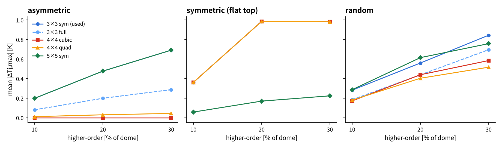
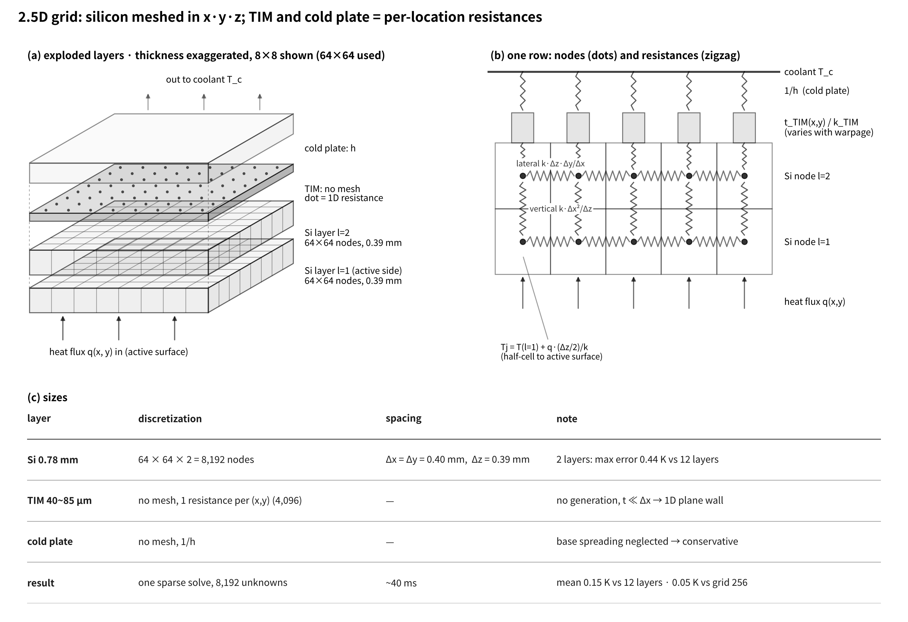
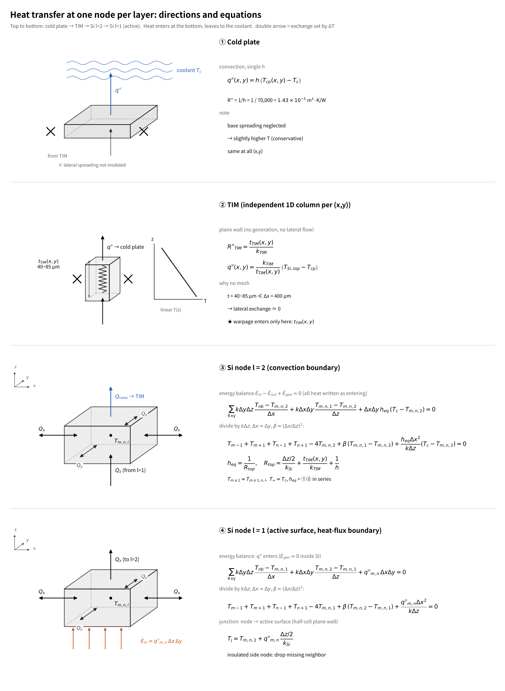
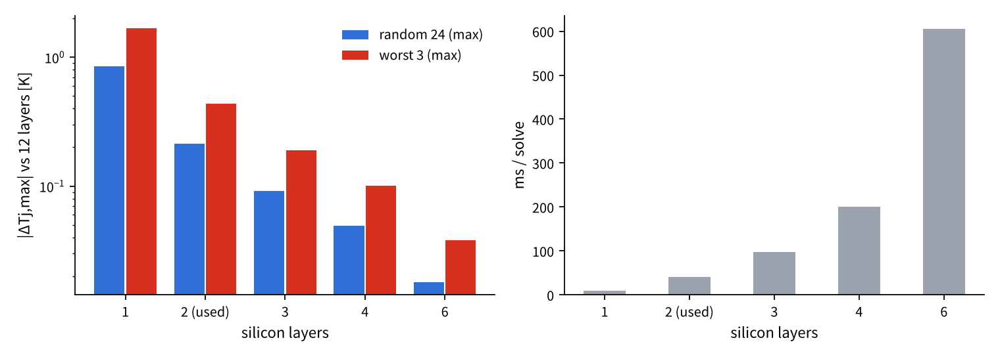
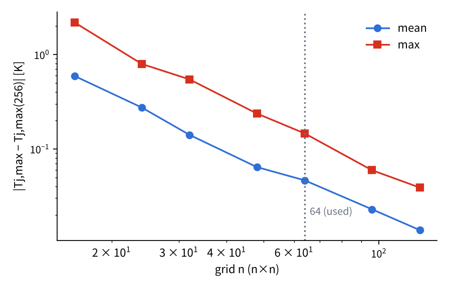
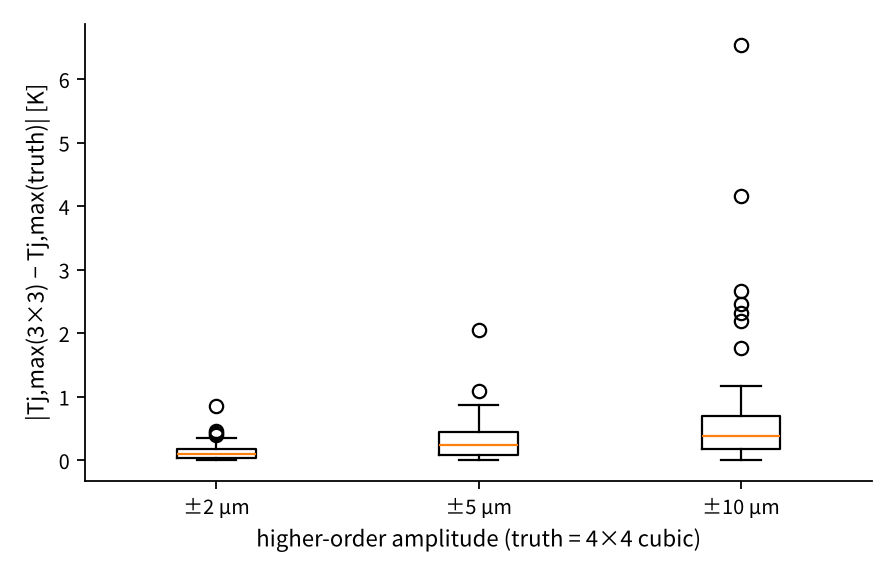
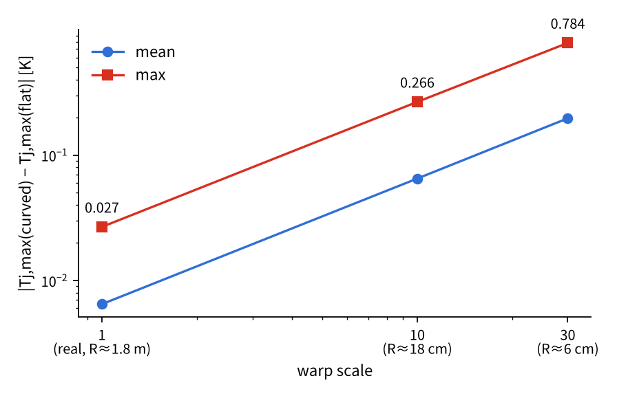

# Role B Report: Geometry & Solver

Topic 6 · Die warpage → non-uniform TIM → junction temperature · Role B · 2026-11-17

## 0. Summary

| Item | Result |
|---|---|
| Solver | Si 64×64×2 nodes + per-location TIM/cold-plate resistance · ~40 ms/solve |
| Warpage | 3×3 symmetric quadratic B-spline + tilt · 5 shape inputs (9 total) |
| Analytic check | uniform case 51.90 °C (hand) = 51.90 °C (solver) · 11/11 tests pass |
| Si layers | 2 vs 12 layers: mean +0.15 K, max 0.44 K |
| Grid | 64 vs 256: mean 0.05 K, max 0.15 K |
| Flat-Si approximation | curved vs flat Si (FEM): max 0.03 K |
| Control net | ±5 μm higher-order: mean 0.3 K · 4×4 adds nothing for symmetric shapes |
| Total solver error | < 1 K (warpage effect: 2–10 K) |
| Pilot (300) | median 82 °C · p99 110 °C · 5% > 105 °C |

## 1. Deliverables

| File | Content | User |
|---|---|---|
| `solver/solver.py` | `solve(x, p)` → (Tj,max, Tj 64×64) | C, D, E |
| `solver/geometry.py` | warpage → t_TIM(x,y) | all |
| `params.yaml` | input order, ranges, constants | all |
| `doe/make_doe.py` | LHS + split | C |
| `tests/test_solver.py` | 11 tests | all |
| `solver/studies/` | verification scripts + results | report |

## 2. Geometry

### 2.1 Inputs (fixed order)

| # | Name | Meaning | Range |
|---|---|---|---|
| 1 | `w_center` | control point, center | 0 – 70 μm |
| 2 | `w_mid_x` | control point, edge mid (x bend) | −20 – 40 μm |
| 3 | `w_mid_y` | control point, edge mid (y bend) | −20 – 40 μm |
| 4–5 | `tilt_x`, `tilt_y` | assembly tilt | ±10 μm (assumed) |
| 6 | `k_tim` | TIM conductivity | 1.5 – 6 W/m·K |
| 7–8 | `hs_x`, `hs_y` | hotspot center | 2 – 23.6 mm |
| 9 | `hs_q` | hotspot peak flux | 80 – 240 W/cm² |

Constraint: warp peak-to-valley (no tilt) ≤ 45 μm.
Fixed: die 25.6 × 25.6 × 0.78 mm · $k_{Si}$ 130 W/m·K · $h$ 7×10⁴ W/m²·K · $T_c$ 25 °C · $q_{avg}$ 80 W/cm² · $t_{min}$ 40 μm · σ_hs 2 mm.

### 2.2 Warpage → TIM thickness

$$
P = \begin{bmatrix} 0 & w_{mid,x} & 0 \\ w_{mid,y} & w_{center} & w_{mid,y} \\ 0 & w_{mid,x} & 0 \end{bmatrix},\quad
w(x,y) = \sum_{i,j} B_i(u)B_j(v)P_{ij} + \text{tilt}_x u' + \text{tilt}_y v'
$$

$$
t_{TIM}(x,y) = t_{min} + \max w - w(x,y)
$$

- Dome (convex to cold plate) at operating temperature → TIM thin at center.
- Si treated as flat (R ≈ 1.8 m); error in 4.5.

### 2.3 Control-net order

Symmetric cubic = quadratic: $P_0=P_3,\ P_1=P_2 \Rightarrow B(t) = P_0 + 3(P_1-P_0)\,t(1-t)$.

Mean |ΔTj,max|, higher-order = 20% of dome, 30 cases:

| Higher-order type | 3×3 sym (used) | 3×3 full | 4×4 cubic | 4×4 quad | 5×5 sym |
|---|---|---|---|---|---|
| asymmetric | 0.48 | 0.20 | 0.00 | 0.03 | 0.48 |
| symmetric | 0.99 | 0.99 | 0.99 | 0.99 | 0.17 |
| random | 0.56 | 0.44 | 0.44 | 0.40 | 0.62 |
| **inputs** | **9** | 12 | 19 | 19 | 14 |

{width=85%}

Symmetric mode added at 2 μm peak-to-valley (40 cases):

| Mode | Net needed | Mean ΔTj,max | Max |
|---|---|---|---|
| 2nd | 3×3 | 0.24 K | 0.71 K |
| 4th | 5×5 | 0.25 K | 0.55 K |
| 6th | 7×7 | 0.30 K | 0.68 K |
| 8th | 9×9 | 0.37 K | 0.81 K |

- ≈ 0.12 K per μm of higher-order amplitude, independent of order.
- Uniform CTE mismatch → constant curvature → quadratic.
- **Decision: 3×3 symmetric + tilt.**

## 3. Solver



### 3.1 Plane wall

$$
Q = \frac{kA}{L}\Delta T,\qquad R = \frac{L}{kA}
$$

| Where | Wall | R'' [m²·K/W] |
|---|---|---|
| TIM | thickness $t_{TIM}(x,y)$ | $t_{TIM}/k_{TIM}$ (exact) |
| Si node ↔ node | spacing Δx or Δz | 3.2 |
| active surface ↔ node l=1 | Δz/2 | $(\Delta z/2)/k_{Si}$ |
| cold plate | convection | $1/h$ |

### 3.2 Energy balance method (finite difference)

Steps: discretize → nodal equations → solve → Tj, Q.

| Dir | Nodes | Spacing | Index |
|---|---|---|---|
| x, y | 64 × 64 | Δx = Δy = 0.40 mm | m, n |
| z | 2 | Δz = 0.39 mm | l (1 = active, 2 = cold side) |

$\dot{E}_{in} - \dot{E}_{out} + \dot{E}_{gen} = 0$, all heat written as entering, $\dot{E}_{gen} = 0$ in Si, $\beta = (\Delta x/\Delta z)^2 = 1.05$.

Node l = 1 (heat flux):

$$
T_{m-1}+T_{m+1}+T_{n-1}+T_{n+1}-4T_{m,n,1}+\beta(T_{m,n,2}-T_{m,n,1})+\frac{q''_{m,n}\Delta x^2}{k\Delta z}=0
$$

Node l = 2 (convection, $T_\infty = T_c$):

$$
T_{m-1}+T_{m+1}+T_{n-1}+T_{n+1}-4T_{m,n,2}+\beta(T_{m,n,1}-T_{m,n,2})+\frac{h_{eq}\Delta x^2}{k\Delta z}(T_c-T_{m,n,2})=0
$$

$$
h_{eq} = \frac{1}{R_{top}},\qquad R_{top} = \frac{\Delta z/2}{k_{Si}} + \frac{t_{TIM}(x,y)}{k_{TIM}} + \frac{1}{h}
$$

Insulated sides: drop missing neighbor (−4T → −3T).
Node at CV center (not on surface) → half-cell walls in $R_{top}$ and $T_j$.



### 3.3 Solution and output

$[A]\{T\} = \{b\}$, 8,192 unknowns, ≤ 7 nonzeros/row, diagonally dominant.

| Method | Type | Time |
|---|---|---|
| Gauss elimination (sparse LU, reordered) — used | direct | 35 ms |
| Gauss elimination (no reordering) | direct | 23.8 s |
| CG | iterative | 13 ms |
| Jacobi | iterative | ~1,200 iterations |

$$
T_j = T_{m,n,1} + q''_{m,n}\frac{\Delta z/2}{k_{Si}}
$$

### 3.4 Hand check (uniform, t = 40 μm, $k_{TIM}$ = 3)

$$
T_j = T_c + q\left(\frac{H}{k_{Si}} + \frac{t}{k_{TIM}} + \frac{1}{h}\right)
$$

| Layer | R'' [m²·K/W] | ΔT [K] | Share |
|---|---|---|---|
| Si | 6.0×10⁻⁶ | 4.8 | 18% |
| TIM | 1.33×10⁻⁵ | 10.7 | 40% |
| cold plate | 1.43×10⁻⁵ | 11.4 | 42% |
| **Tj** | | **25 + 26.9 = 51.90 °C** | solver 51.90 °C |

## 4. Verification

### 4.1 Tests (`pytest -q`, 11 pass)

| Test | Result |
|---|---|
| analytic uniform, 1/2/3 layers | machine precision |
| energy balance | rel. error < 10⁻⁸ |
| symmetric input → symmetric output | ✓ |
| dome → thin TIM at center; thicker TIM → hotter | ✓ |
| more layers → closer to reference | ✓ |

### 4.2 Si layers (reference 12)

{width=85%}

| Layers | Mean | Max (random) | Max (worst) | ms |
|---|---|---|---|---|
| 1 | +0.59 | 0.85 | 1.67 | 9 |
| **2** | **+0.15** | **0.21** | **0.44** | **41** |
| 3 | +0.06 | 0.09 | 0.19 | 98 |
| 4 | +0.03 | 0.05 | 0.10 | 201 |

### 4.3 Grid (reference 256, 2 layers)

{width=55%}

| Grid | Mean | Max | ms |
|---|---|---|---|
| 32 | 0.14 | 0.54 | 6 |
| 48 | 0.06 | 0.24 | 16 |
| **64** | **0.05** | **0.15** | **35** |
| 96 | 0.02 | 0.06 | 111 |

### 4.4 3×3 fit error (truth = 4×4 cubic, 60 cases/level)

{width=55%}

| Higher-order | Mean | Max |
|---|---|---|
| ±2 μm | 0.13 K | 0.86 K |
| ±5 μm | 0.32 K | 2.05 K |
| ±10 μm | 0.70 K | 6.54 K |

### 4.5 Flat vs curved silicon (3D FEM)

| Case | Si geometry | Same |
|---|---|---|
| flat | $z \in [-H, 0]$ | $t_{TIM}(x,y)$, $q(x,y)$, mesh topology |
| curved | $z \in [-H, 0] + s\,w(x,y)$ | |

Hex FEM 64×64×6, 16 cases, area factor $\sqrt{1+|\nabla w|^2}$ applied.

{width=55%}

| Scale s | R | Mean | Max |
|---|---|---|---|
| **1 (real)** | **1.8 m** | **0.006 K** | **0.027 K** |
| 10 | 18 cm | 0.065 K | 0.27 K |
| 30 | 6 cm | 0.20 K | 0.78 K |

- Error ∝ curvature; flat Si slightly conservative.
- Same flat case, 2.5D FD vs 3D FEM: mean 0.13 K, max 0.30 K.

### 4.6 Error budget (Tj,max)

| Source | Mean | Max | Sign |
|---|---|---|---|
| 2 Si layers | 0.15 K | 0.44 K | + (safe) |
| grid 64 | 0.05 K | 0.15 K | ± |
| 3×3 net (±5 μm) | 0.3 K | 2 K | ± |
| flat Si | 0.006 K | 0.03 K | + (safe) |
| cold-plate spreading | C (3D) | | + (safe) |

## 5. Pilot and handoff

| Pilot (300) | Value |
|---|---|
| median Tj,max | 82 °C |
| p99 | 110 °C |
| > 105 °C | 5% |

| To | Handoff |
|---|---|
| C | `solve(x, p)` · `python doe/make_doe.py --n 500 --out data/data_v1` · same x for 3D check |
| D | 9 inputs (`params.yaml`) · solver error < 1 K |
| E | field 64×64 (row = y), grid converged |
| A | measured higher-order warp amplitude · tilt range |

## 6. Assumptions

| Assumption | Effect | Status |
|---|---|---|
| quadratic symmetric warp + tilt | 0.12 K/μm higher-order | needs measured data |
| single $h$ | conservative | C (3D) |
| steady state | no transients | hotspot ≥ ms |
| constant $k_{Si}$ | slightly low T at high T | — |
| insulated sides | side area 12% of top | — |
| tilt ±10 μm, $h$ = 7×10⁴ | assumed | A to confirm |

## 7. Reproduce

```bash
pytest -q
python solver/studies/layer_count.py && python solver/studies/layer_count_plot.py
python solver/studies/grid_convergence.py
python solver/studies/control_net_order.py
python solver/studies/control_net_4x4_analysis.py
python solver/studies/mode_sensitivity.py
python solver/studies/curvature_effect.py      # ~8 min, scikit-fem
python solver/studies/report_figs_en.py        # English plots from results/
python solver/studies/figs_en_drawings.py      # English diagrams
```

## Appendix: Symbols

| Symbol | Meaning | Value |
|---|---|---|
| $(m,n,l)$ | node index (x, y, z) | l = 1 active, 2 cold side |
| $\Delta x, \Delta z$ | spacing | 0.40, 0.39 mm |
| $\beta$ | $(\Delta x/\Delta z)^2$ | 1.05 |
| $k_{Si}, k_{TIM}$ | conductivity | 130; 1.5–6 W/m·K |
| $t_{TIM}$ | TIM thickness | 40–85 μm |
| $h, h_{eq}$ | cold plate; equivalent top | 7×10⁴; $1/R_{top}$ W/m²·K |
| $T_c$ | coolant | 25 °C |
| $q''$ | active-surface flux | 80 W/cm² + hotspot |
| $H$ | die thickness | 0.78 mm |
| $T_j$ | junction temperature | °C |
