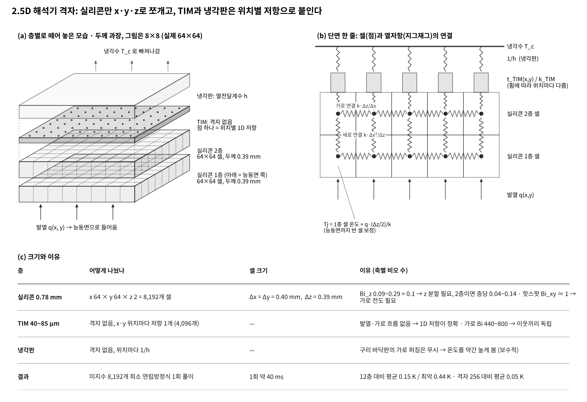
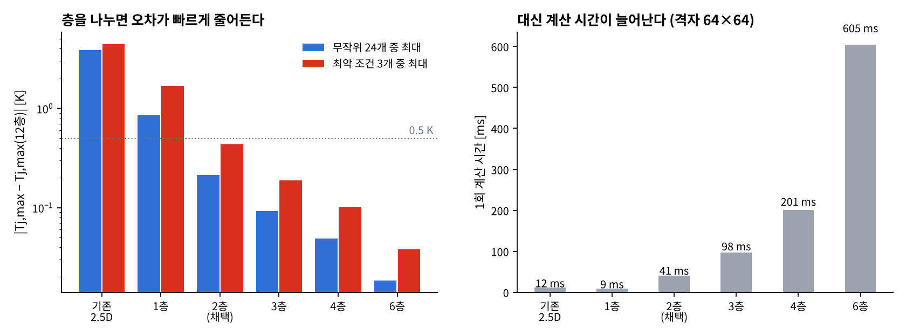
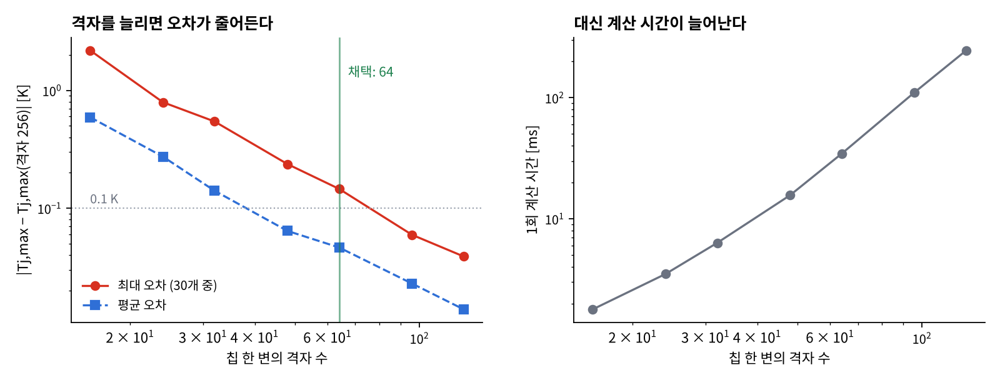
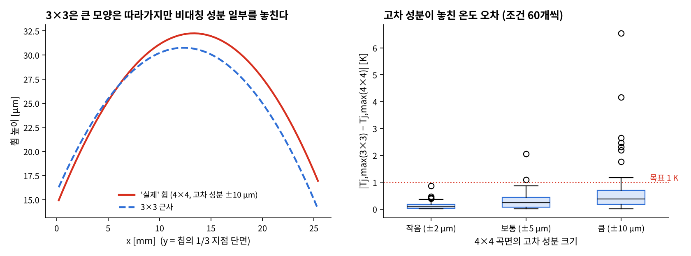

# solver — B 담당: 형상·해석기

**책임지는 질문: 해석기를 믿을 수 있나?**

## 해석기 구조 (다층 2.5D, 정상상태)

```
냉각수 T_c ─ 1/h ─ TIM: 위치별 1D 저항 t_tim(x,y)/k_tim ─ 실리콘 2층 (x·y·z 전도) ─ 능동면 발열 q(x,y)
```

- `geometry.py` — 3×3 제어점 2차 B-spline 휨 곡면 + 조립 기울기 → TIM 두께 지도
- `solver.py` — `solve(x, p)` → `(Tj,max, Tj 지도 64×64)`. 층 수는 `params.yaml`의 `solver.si_layers`
- 1회 계산 약 35~40 ms (격자 64×64, 실리콘 2층) → 데이터 2,500개 약 1.5분



## 축별 비오 수로 정한 단순화

Bi_z = (층 두께 저항) ÷ (그 층에서 냉각수까지의 저항), Bi_xy = (Lc / λ)², λ = √(k·t·R_바깥) = 옆으로 퍼지는 거리.
(Lc: 칩 반폭 12.8 mm 또는 핫스팟 σ 2 mm. TIM 40~85 μm, k_TIM 1.5~6 W/m·K 범위)

| 층 | Bi_z | Bi_xy (칩) | Bi_xy (핫스팟) | 모델링 |
|---|---|---|---|---|
| 실리콘 0.78 mm | 0.09~0.29 | 23~77 | 0.6~1.9 | x·y 격자로 풀기, **z는 2층** (층당 Bi 0.04~0.14) |
| TIM | 0.5~4.0 | — | 440~800 | 위치별 독립 1D 저항 (발열·가로 흐름 없음 → 정확) |
| 냉각판 (구리 1~3 mm 가정) | 0.18~0.54 | 10~29 | 0.24~0.72 | h 하나 (바닥판 가로 퍼짐 무시 → 온도를 높게 봄, 보수적) |

## 검증 결과

### 1. 해석해·물리 법칙 (`tests/`, `pytest -q` → 11개 통과)
- 균일 조건: 층 수(1·2·3)와 상관없이 1D 해석해 T = T_c + q·R과 일치
- 에너지 보존: 발열 총량 = 냉각수로 나간 열 (상대오차 < 1e-8)
- 대칭, 볼록 휨 TIM 분포, k_TIM 경향, 층 수 회귀 테스트

### 2. 실리콘 층 수 (`studies/layer_count.py`, 기준 = 12층)


| 모델 | 무작위 24개 평균 | 무작위 최대 | 최악 조건 최대 | 1회 |
|---|---|---|---|---|
| 기존 2.5D (옆 전도를 능동면 온도로 계산) | −2.78 K | 3.88 K | 4.44 K | 12 ms |
| 1층 (층 중심 온도로 계산) | +0.59 K | 0.85 K | 1.67 K | 9 ms |
| **2층 (채택)** | **+0.15 K** | **0.21 K** | **0.44 K** | **41 ms** |
| 3층 | +0.06 K | 0.09 K | 0.19 K | 98 ms |
| 4층 | +0.03 K | 0.05 K | 0.10 K | 201 ms |

- 기존 2.5D의 큰 오차(온도를 **낮게** 봄)는 대부분 옆 전도를 가장 뜨거운 능동면 온도로 계산한 탓이었다.
- 같은 1층이라도 층 중심 온도로 계산하면 오차가 1.7 K 이하로 줄고, 2층이면 0.44 K 이하. 2층 이상은 온도를 아주 약간 높게 본다(안전한 쪽).
- 최악 조건 = 얇고 좋은 TIM(40 μm, 6 W/m·K, Bi 최대) + 강한 핫스팟(σ 1~2 mm).

### 3. 격자 수렴 (`studies/grid_convergence.py`, 기준 = 격자 256, 실리콘 2층)


| 격자 | 평균 오차 | 최대 오차 | 1회 |
|---|---|---|---|
| 32 | 0.14 K | 0.54 K | 6 ms |
| 48 | 0.06 K | 0.24 K | 16 ms |
| **64 (채택)** | **0.05 K** | **0.15 K** | **35 ms** |
| 96 | 0.02 K | 0.06 K | 111 ms |

### 4. 제어점 3×3이면 충분한가 (`studies/control_net_order.py`)


'실제' 휨 = 4×4 제어점 3차 곡면 (돔 10~40 μm + 무작위 고차 성분). 이를 3×3으로 최소제곱 근사했을 때 Tj,max 차이 (조건 60개씩):

| 고차 성분 크기 | 평균 | 최대 |
|---|---|---|
| ±2 μm | 0.13 K | 0.86 K |
| ±5 μm | 0.32 K | 2.05 K |
| ±10 μm | 0.70 K | 6.54 K |

- 고차 성분이 휨의 10~15%(±5 μm) 이하면 평균 0.3 K로 충분하다.
- 크면 일부 조건에서 수 K까지 벌어진다 → **한계로 명시**.
- 4×4로 늘리는 효과 정밀 분석: [`docs/b_control_net_3x3_vs_4x4.pdf`](../docs/b_control_net_3x3_vs_4x4.pdf) — 4×4는 비대칭 고차만 개선, 대칭 고차는 개선 없음(대칭 3차 = 2차), 입력 9 → 19개. **3×3 대칭 + 기울기 유지**.

## 오차 예산 요약 (Tj,max, 채택 설정)

| 원인 | 평균 | 최대 | 방향 |
|---|---|---|---|
| 실리콘 2층 | 0.15 K | 0.2~0.4 K | 약간 높게 (안전) |
| 격자 64 | 0.05 K | 0.15 K | — |
| 제어점 3×3 (고차 성분 ±5 μm 가정) | 0.3 K | 2 K | 양쪽 |
| 냉각판 바닥 퍼짐 무시 | C의 Ansys로 확인 예정 | | 높게 (안전) |

휨 효과(2~10 K)보다 충분히 작다. 해석기 자체의 오차는 1 K 미만, 휨 모양 표현의 오차가 가장 큰 항목.

## 다른 역할에 넘기는 것

- **C**: `solve(x, p)`로 데이터 생성 (`doe/make_doe.py`가 이미 사용). Ansys 3D 비교 시 같은 x로 `solve` 결과와 비교하면 된다. 냉각판 바닥판 두께를 알려 주면 퍼짐 효과 영향을 함께 볼 수 있다.
- **A**: 2층 해석기로 바꾼 뒤 파일럿 300개 중 Tj,max > 105°C 비율 = 5% (기존 1%). 중앙값 82°C, 상위 1% 110°C.

## 재현

```bash
pytest -q
python solver/studies/layer_count.py        # 약 4분
python solver/studies/grid_convergence.py   # 약 3분
python solver/studies/control_net_order.py  # 약 1분
```
결과 CSV: `solver/studies/results/`, 그림: `figures/b_*.png`
