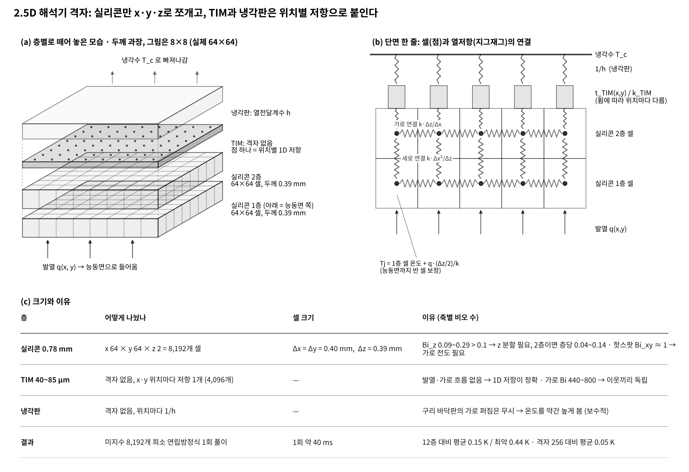
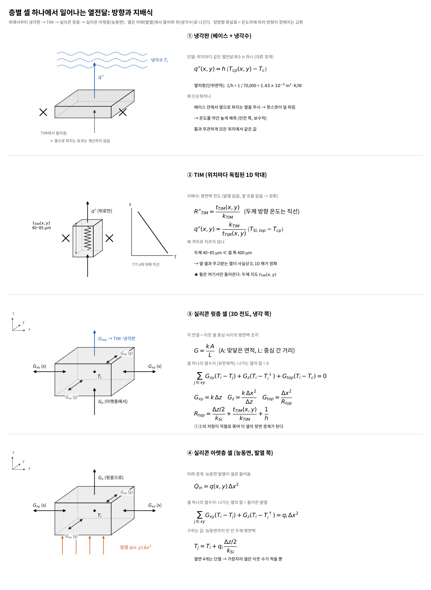

# 2.5D 해석기의 전도 열전달 계산 원리

> VS Code에서 `Ctrl+Shift+V`(Mac은 `Cmd+Shift+V`)를 누르면 수식과 그림이 보이는 미리보기가 열립니다.
> 코드: [`solver.py`](solver.py)의 `solve_fields()` · 그림: [`b_mesh_diagram_v1.png`](../figures/b_mesh_diagram_v1.png)

---

## 0. 한 줄 요약

**칩을 검사체적 8,192개로 자르고, 각 중심 절점마다 에너지 평형식("들어온 열의 합 = 0")을 세운 뒤, 그 연립방정식을 한 번에 푼다.**
열은 전기처럼 다룬다. 온도차는 전압, 열량은 전류, 열저항은 저항이다.

---

## 1. 기본 식: 평면벽 전도 (열의 옴의 법칙)

해석기 전체가 이 식 하나로 만들어진다. 두께 $L$, 면적 $A$, 열전도율 $k$인 벽을 지나는 열은

$$
Q = \frac{k A}{L}\,\Delta T = \frac{\Delta T}{R}, \qquad R = \frac{L}{kA}
$$

| 쓰이는 곳 | 벽 | 저항 (단위면적, m²·K/W) | 정확도 |
|---|---|---|---|
| TIM | 두께 $t_{TIM}(x,y)$인 평면벽 그 자체 | $t_{TIM}/k_{TIM}$ | 발열·옆 흐름이 없어 **정확** |
| 실리콘 절점 사이 | 이웃 절점 사이의 작은 평면벽 조각 | 2.2절 | 간격이 작을수록 정확 (격자 수렴으로 확인) |
| 능동면 → $l=1$ 절점 | 반 칸 두께($\Delta z/2$) 평면벽 | $(\Delta z/2)/k_{Si}$ | 정확 |
| 냉각판 | 벽 대신 대류 ($Q = hA\,\Delta T$) | $1/h$ | 모델 가정 |

### 왜 실리콘은 평면벽 하나로 끝나지 않나

칩 전체를 평면벽 하나로 보면 $T_j = T_c + q\,(H/k_{Si} + t_{TIM}/k_{TIM} + 1/h)$ 한 줄이면 끝난다 (6장 손계산). 하지만 이 식은 **열이 위로만 흐를 때**만 맞다. 핫스팟 열은 실리콘 안에서 옆으로 퍼지고, TIM 두께도 위치마다 다르다. 그래서 실리콘을 작은 평면벽 조각들의 **그물**(x, y, z 모든 방향)로 나눠 푼다.

> 참고: 간격을 무한히 작게 하면 이 그물은 3D 정상상태 열전도 방정식 $\nabla\cdot(k\nabla T)=0$과 같아진다. 해석기가 실제로 계산하는 것은 절점마다의 에너지 평형식이다.

### 가정과 경계

- **정상상태**: 핫스팟이 머무는 시간(ms 이상)이 칩이 평형에 이르는 시간보다 길다.
- **내부 발열 없음**: 열은 맨 아래 **능동면**(트랜지스터 층, 두께 수 μm)에서만 생긴다. 그래서 아랫면으로 들어오는 열 $q(x,y)$로 넣는다.

| 면 | 조건 | 의미 |
|---|---|---|
| 아랫면 (능동면) | 열 $q(x,y)\,\Delta x^2$가 $l=1$ 절점으로 들어옴 | 평균 발열 + 가우시안 핫스팟 |
| 윗면 | 반 칸 실리콘 → TIM → 냉각판 → 냉각수, **평면벽 직렬** | 휨이 들어가는 곳 (3장) |
| 옆면 4개 | 단열 | 옆으로 새는 열은 무시 |

---

## 2. 어떻게 푸는가: 유한차분법 – 에너지 평형법 (Energy Balance Method)

순서는 네 단계다.

1. **이산화**: 격자 간격 $\Delta x, \Delta y, \Delta z$를 정한다.
2. **절점 방정식**: 절점마다 에너지 평형식을 쓴다. 미지 절점온도 $n$개에 대해 식 $n$개가 나온다.
3. **연립방정식 풀이**: 5장.
4. **결과 계산**: 절점온도와 열량 $Q$를 구한다. 4장과 7장.

### 2.1 이산화 (step 1)

| 방향 | 분할 | 간격 | 절점 번호 |
|---|---|---|---|
| x | 64 | $\Delta x = 25.6\,\text{mm}/64 = 0.4\,\text{mm}$ | $m$ |
| y | 64 | $\Delta y = \Delta x$ | $n$ |
| z (실리콘) | 2 | $\Delta z = 0.78\,\text{mm}/2 = 0.39\,\text{mm}$ | $l$ ($l=1$ 능동면 쪽, $l=2$ 냉각 쪽) |

절점 $(m,n,l)$은 검사체적 $\Delta x\,\Delta y\,\Delta z$의 **중심**에 둔다. 미지 절점온도는 $64 \times 64 \times 2 = 8{,}192$개다.

### 2.2 절점 사이 전도 (평면벽)

이웃 절점에서 절점 $(m,n,l)$로 **들어오는** 전도열은 두 절점 사이 평면벽의 열량이다.

$$
Q = kA\,\frac{T_{\text{이웃}} - T_{m,n,l}}{\text{절점 간 거리}}
$$

| 방향 | 전열 면적 $A$ | 거리 | 계수 $kA/\text{거리}$ [W/K] | 코드 |
|---|---|---|---|---|
| x, y | $\Delta y\,\Delta z$ | $\Delta x$ | $k\,\Delta z$ | `gx = k * dz` |
| z | $\Delta x\,\Delta y$ | $\Delta z$ | $k\,\Delta x^2/\Delta z$ | `gz = k * dx * dx / dz` |

### 2.3 절점 방정식 (step 2)

정상상태 에너지 평형: $\dot{E}_{in} - \dot{E}_{out} + \dot{E}_{gen} = 0$. 모든 열을 절점으로 "들어온다"고 쓰면, 들어오는 열의 합이 0이 된다. 실리콘 내부에는 $\dot{E}_{gen} = 0$이다.

**내부 절점** (위아래 이웃이 모두 있는 경우의 일반형):

$$
\sum_{4\,\text{xy}} k\,\Delta y\Delta z\,\frac{T_{\text{nb}} - T_{m,n,l}}{\Delta x}
+ k\,\Delta x\Delta y\,\frac{T_{m,n,l-1} - T_{m,n,l}}{\Delta z}
+ k\,\Delta x\Delta y\,\frac{T_{m,n,l+1} - T_{m,n,l}}{\Delta z} = 0
$$

$k\Delta z$로 나누고 $\Delta x = \Delta y$, $\beta = (\Delta x/\Delta z)^2$로 두면 (약식 $T_{m\pm1} = T_{m\pm1,n,l}$):

$$
T_{m-1} + T_{m+1} + T_{n-1} + T_{n+1} - 4T_{m,n,l} + \beta\left(T_{m,n,l-1} + T_{m,n,l+1} - 2T_{m,n,l}\right) = 0
$$

이 문제는 z 방향이 2층이라, 모든 절점이 아래 둘 중 하나의 **경계 절점**이다.

**$l=1$ 절점 (능동면, 열유속 경계)**: 아래 이웃 대신 열유속 $q''_{m,n}$이 들어온다.

$$
T_{m-1} + T_{m+1} + T_{n-1} + T_{n+1} - 4T_{m,n,1} + \beta\left(T_{m,n,2} - T_{m,n,1}\right) + \frac{q''_{m,n}\,\Delta x^2}{k\,\Delta z} = 0
$$

**$l=2$ 절점 (냉각 쪽, 대류 경계)**: 위 이웃 대신 등가 대류로 냉각수($T_\infty = T_c$)와 열을 주고받는다.

$$
T_{m-1} + T_{m+1} + T_{n-1} + T_{n+1} - 4T_{m,n,2} + \beta\left(T_{m,n,1} - T_{m,n,2}\right) + \frac{h_{eq}\,\Delta x^2}{k\,\Delta z}\left(T_c - T_{m,n,2}\right) = 0,
\qquad h_{eq} = \frac{1}{R_{\text{top}}}
$$

$R_{\text{top}}$은 반 칸 실리콘, TIM, 냉각판이 직렬로 이어진 저항이다 (3장). 휨은 $t_{TIM}(x,y)$를 통해 $h_{eq}$로만 들어온다.

**옆면 절점 (단열)**: 없는 이웃의 항을 빼면 된다. 예를 들어 $m=1$이면 $T_{m-1}$ 항이 없고 $-4T$가 $-3T$가 된다.

이렇게 8,192개의 1차 연립방정식이 만들어진다.

> 강의 노트와 다른 점 하나: 노트는 경계 절점을 표면 위에 두고 반쪽 검사체적을 쓴다. 이 해석기는 절점을 검사체적 중심에 두고, 표면까지 남은 반 칸($\Delta z/2$)을 평면벽 저항으로 처리한다. 그래서 $R_{\text{top}}$에 $\Delta z/(2k)$가 들어가고, 능동면 온도는 4장처럼 보정한다.

### 2.4 층별로 본 절점 하나: 열의 방향과 식

| 층 | 열이 흐르는 방향 | 지배식 | 격자 |
|---|---|---|---|
| ① 냉각판 | 위(냉각수)로만 | $q'' = h\,(T_{cp}-T_c)$ | 없음 (계수 하나) |
| ② TIM | 위로만 (옆 흐름 없음) | 평면벽: $q'' = \dfrac{k_{TIM}}{t_{TIM}(x,y)}\,\Delta T$ | 없음 (위치별 평면벽) |
| ③ 실리콘 윗층 ($l=2$) | x·y 이웃 4개 + 아래 1개 + 위 대류 경계 | 에너지 평형 (대류 경계 절점) | 64×64 |
| ④ 실리콘 아랫층 ($l=1$) | x·y 이웃 4개 + 위 1개 + 아래 열유속 유입 | 에너지 평형 (열유속 경계 절점) | 64×64 |

---

## 3. 휨이 들어가는 곳: 윗면 직렬 저항

$l=2$ 절점에서 냉각수까지는 저항 세 개가 **직렬**로 이어진다 (단위 면적당, m²·K/W).

$$
R_{\text{top}}(x,y) \;=\; \underbrace{\frac{\Delta z/2}{k_{\text{Si}}}}_{\text{절점→윗면}} \;+\; \underbrace{\frac{t_{\text{TIM}}(x,y)}{k_{\text{TIM}}}}_{\text{TIM}} \;+\; \underbrace{\frac{1}{h}}_{\text{냉각판}}
\qquad
h_{eq} = \frac{1}{R_{\text{top}}}
$$

- **휨 곡면 → TIM 두께 지도 $t_{\text{TIM}}(x,y)$ → 위치마다 다른 $R_{\text{top}}$**. 휨은 오직 이 한 줄로 해석에 들어간다.
- 돔 모양 휨이면 중앙은 TIM이 얇아(저항 작음) 잘 식고, 가장자리·모서리는 두꺼워(저항 큼) 덜 식는다.

### 왜 TIM과 냉각판은 격자로 자르지 않나

| 층 | 단순화 | 근거 |
|---|---|---|
| TIM | 위치별 1D 저항 | 내부 발열이 없고, 두께(40~85 μm)가 격자 간격(400 μm)보다 훨씬 얇아 옆으로 흐르는 열이 무시할 만하다. 각 위치가 독립된 1D 막대처럼 행동하므로 1D 저항으로 충분하다. |
| 냉각판 | 하나의 열전달계수 $h$ | 냉각판 바닥에서 옆으로 퍼지는 효과를 무시. 핫스팟이 덜 퍼지는 쪽이라 온도를 **높게** 예측한다 (보수적). |
| 실리콘 | 3D 격자 (xy 64×64, z 2층) | z 방향 온도차를 무시하면(1층) 최대 오차 0.85 K, 2층으로 나누면 0.21 K. 그래서 2층으로 나눈다. |

> 이것이 "2.5D"인 이유다. 실리콘만 진짜 3D로 풀고, 얇은 층들은 저항 하나로 압축한다.

---

## 4. 결과 계산 (step 4): 능동면 온도 $T_j$

절점은 검사체적 중심에 있다. 알고 싶은 것은 맨 아래 **능동면**의 온도 $T_j$다. $l=1$ 절점에서 능동면까지 반 칸($\Delta z/2$) 두께의 평면벽이 남으므로, 그만큼의 온도 상승을 더한다.

$$
T_j(m,n) = T_{m,n,1} + q''_{m,n}\,\frac{\Delta z / 2}{k_{\text{Si}}}
$$

코드: `Tj = T[0] + q * (dz / 2) / k`

냉각수로 나가는 열 $Q = \sum \Delta x^2\,h_{eq}\,(T_{m,n,2} - T_c)$는 들어온 열 $\sum q''\Delta x^2$와 같아야 한다 (7장 에너지 보존 시험).

---

## 5. 연립방정식 풀이 (step 3)

### 5.1 행렬 형태

$$
[A]\{T\} = \{b\}
$$

- $[A]$ (8,192 × 8,192): 2.3절 식의 계수. 한 행에 0이 아닌 값이 최대 7개다. 대각 성분이 나머지 성분 절댓값의 합 이상이라 **대각 우세**다.
- $\{b\}$: 열유속 항 $q''\Delta x^2$와 냉각수 항 $h_{eq}\Delta x^2\,T_c$.

### 5.2 풀이: Gauss 소거법 (직접법)

Gauss 소거법을 LU 분해 형태로 쓴다 (`scipy.sparse.linalg.spsolve`). 0이 많은 행렬이라, 소거 전에 행·열 순서를 바꿔 새로 생기는 0이 아닌 값을 줄인다.

| 방법 | 분류 | 시간 (8,192개) |
|---|---|---|
| Gauss 소거 (LU), 순서 재배치 (현재) | 직접법 | 약 35 ms |
| Gauss 소거 (LU), 재배치 없음 | 직접법 | 약 23.8 s |
| 공액기울기법 CG | 반복법 | 약 13 ms |
| Jacobi | 반복법 | 수렴에 약 1,200회 |

$[A]$가 대각 우세라 반복법도 수렴한다. 하지만 한 번에 35 ms면 데이터 수천 개도 몇 분 안에 끝나므로, 반복 횟수나 수렴 판정이 필요 없는 직접법을 쓴다.

---

## 6. 손계산 예제: 해석기가 맞는지 확인하는 법

TIM 두께가 어디서나 같고($t = 40\,\mu\text{m}$) 발열도 균일하면($q = 80\,\text{W/cm}^2$) 옆으로 흐르는 열이 없다. 그러면 온도는 직렬 저항만으로 계산된다.

$$
T_j = T_c + q\left(\frac{H}{k_{\text{Si}}} + \frac{t}{k_{\text{TIM}}} + \frac{1}{h}\right)
$$

$k_{\text{TIM}} = 3$ W/m·K를 넣으면:

| 구간 | 저항 [m²·K/W] | 온도 상승 [K] | 비중 |
|---|---|---|---|
| 실리콘 $H/k$ = 0.78 mm / 130 | $6.0\times10^{-6}$ | 4.8 | 18% |
| TIM $t/k$ = 40 μm / 3 | $1.33\times10^{-5}$ | 10.7 | 40% |
| 냉각판 $1/h$ = 1 / 70,000 | $1.43\times10^{-5}$ | 11.4 | 42% |
| **합계** | $3.36\times10^{-5}$ | **26.9** | |

$T_j = 25 + 26.9 = 51.90\,°\text{C}$이고, 해석기 결과도 **51.90 °C**로 일치한다 (`tests/test_solver.py`의 해석해 시험).

> **이 표가 주는 통찰**: TIM이 전체 열저항의 40%를 차지한다. 그래서 휨 때문에 TIM 두께가 수십 μm만 달라져도 Tj가 크게 움직인다. 이것이 이 프로젝트의 출발점이다.

---

## 7. 해석기를 믿을 수 있는 근거

| 시험 | 결과 |
|---|---|
| 균일 조건 해석해 비교 (1·2·3층) | 기계 정밀도로 일치 |
| 에너지 보존 (들어온 열 = 냉각수로 나간 열) | 일치 |
| x·y 대칭 입력 → 대칭 출력 | 일치 |
| 격자 수렴 (64×64 vs 더 촘촘한 격자) | 평균 0.05 K, 최대 0.15 K 차이 |
| 층 수 수렴 (2층 vs 12층) | 평균 0.15 K, 최대 0.44 K 차이 |

---

## 부록: 기호표

| 기호 | 뜻 | 값 / 단위 |
|---|---|---|
| $k_{\text{Si}}$ | 실리콘 열전도율 | 130 W/m·K |
| $k_{\text{TIM}}$ | TIM 열전도율 | 1.5~6 W/m·K (입력) |
| $t_{\text{TIM}}(x,y)$ | TIM 두께 지도 | 40 μm + 휨 깊이 |
| $h$ | 냉각판 열전달계수 | 70,000 W/m²·K |
| $T_c$ | 냉각수 온도 | 25 °C |
| $q''_{m,n}$ ($q(x,y)$) | 능동면 열유속 | 평균 80 W/cm² + 핫스팟 |
| $H$ | 다이 두께 | 0.78 mm |
| $\Delta x,\ \Delta z$ | 격자 간격 | 0.4 mm, 0.39 mm |
| $(m,n,l)$ | 절점 번호 (x, y, z) | $l=1$ 능동면 쪽, $l=2$ 냉각 쪽 |
| $\beta$ | $(\Delta x/\Delta z)^2$ | 1.05 |
| $h_{eq}$ | 윗면 등가 대류계수 $=1/R_{top}$ | W/m²·K |
| $\dot{E}_{in},\ \dot{E}_{out},\ \dot{E}_{gen}$ | 들어온 / 나간 / 생성 열 | W |
| $R$ | 단위면적 열저항 | m²·K/W |
